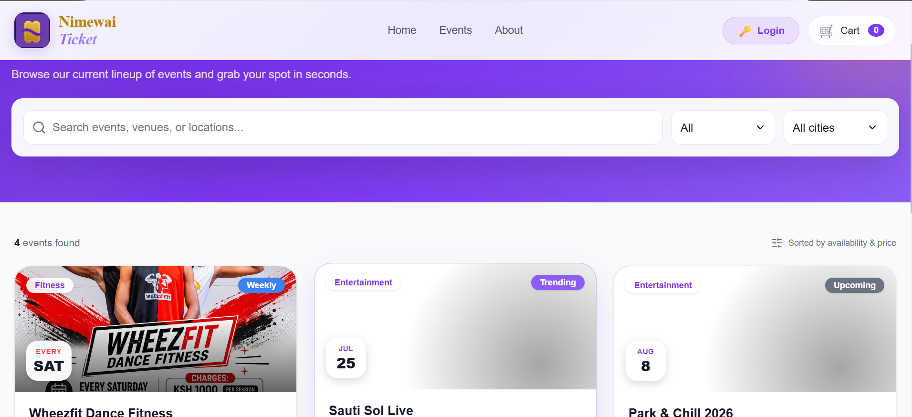
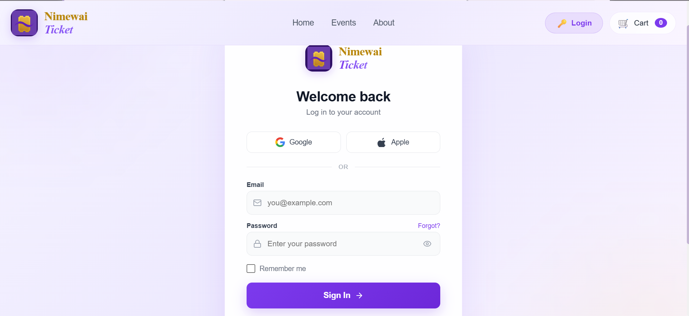
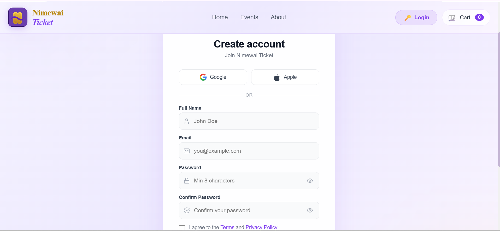
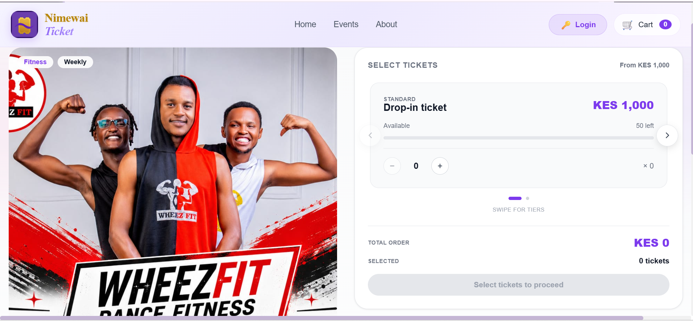
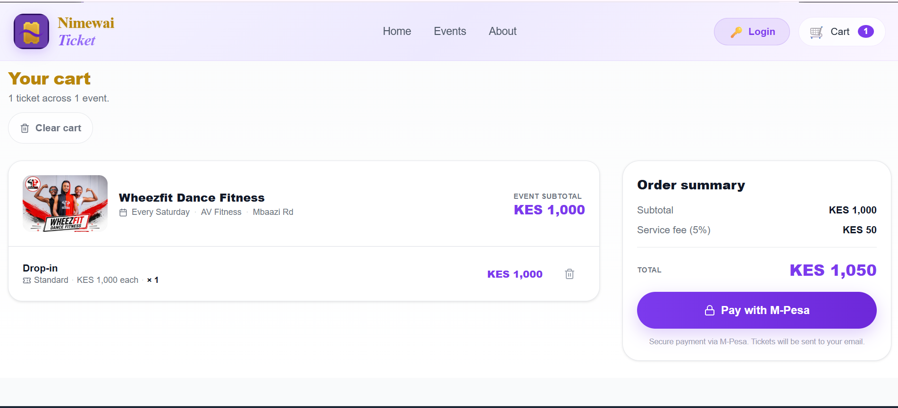
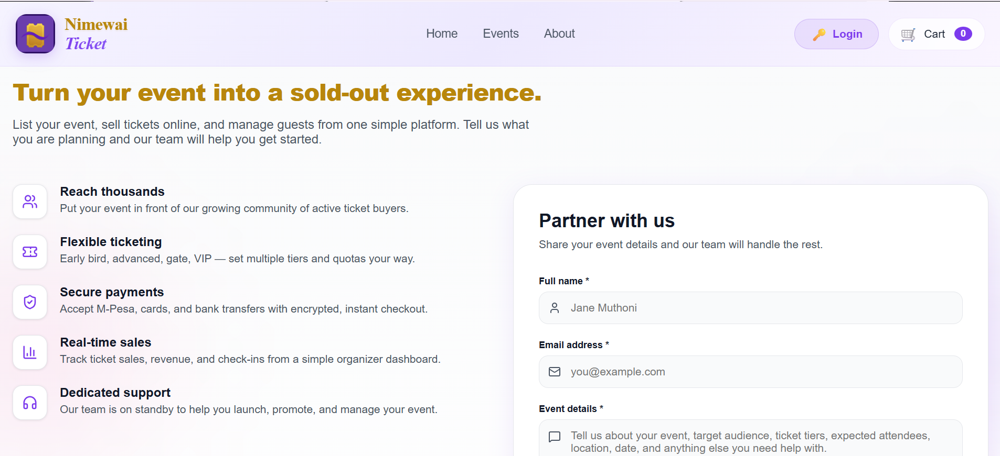

# Nimewahi Ticket 

**A Full-Stack Event Ticketing and Management Platform**

Nimewahi Ticket is an event ticketing platform designed to simplify event discovery, ticket purchasing and event organisation. It provides users with an accessible way to explore events and purchase tickets, while giving event organisers a platform to showcase and manage their events.

The project was developed using React, JavaScript, Firebase and a Node.js backend, with M-PESA payment integration and QR-based ticket functionality.

## Application Screenshots

### 1. Homepage


### 2. Events Listing


### 3. User Authentication


### 4. User Registration


### 5. Ticket Selection and Purchase


### 6. Shopping Cart and M-PESA Checkout


### 7. Organizer Partnership


## Key Features

- **Event Discovery:** Browse and explore available events.
- **User Authentication:** Secure user registration and login.
- **Ticket Purchasing:** Select ticket categories and quantities.
- **M-PESA Integration:** Daraja API sandbox integration for initiating STK Push payment requests.
- **QR-Based Ticketing:** QR code functionality for digital ticket identification and scanning.
- **Organizer Interface:** An interface for event organisers to engage with the platform.
- **Firebase Integration:** Backend data management and application services.

## Technology Stack

| Category | Technologies |
|---|---|
| Frontend | React.js, JavaScript, HTML5, CSS3 |
| Backend | Node.js |
| Database and Services | Firebase |
| Payment Integration | Safaricom Daraja API |
| Development Tools | Vite, Git, GitHub |
| HTTP Requests | Axios |

## Project Structure

```text
nimewai-ticket/
│
├── backend/
│   ├── server.js
│   └── package.json
│
├── public/
├── src/
├── NTscreenshots/
│   ├── HomePage.png
│   ├── EventsPage.png
│   ├── LoginPage.png
│   ├── SignupPage.png
│   ├── PurchasePage.png
│   ├── Mpesapromptpage.png
│   └── OrganizerPage.png
│
├── package.json
└── README.md
```

## Installation and Setup

### Prerequisites

- Node.js and npm
- Git
- Firebase project configuration
- Safaricom Daraja developer account for M-PESA testing

### 1. Clone the repository

```bash
git clone https://github.com/TykoonKelly/nimewai-ticket.git
```

### 2. Navigate into the project

```bash
cd nimewai-ticket
```

### 3. Install dependencies

```bash
npm run setup
```

### 4. Configure environment variables

Configure the required Firebase and backend environment variables using the application's existing configuration.

For M-PESA integration, configure your Daraja sandbox credentials on the backend. Never commit API secrets, passwords or private credentials to GitHub.

### 5. Start the frontend

Open a terminal and run:

```bash
npm run dev
```

### 6. Start the backend

Open a second terminal and run:

```bash
npm run backend
```

Both services should remain running during local development.

## Development Status

Nimewahi Ticket is an actively developed project.

- Frontend application: Implemented.
- Backend server: Implemented and starts successfully.
- User authentication: Implemented.
- Daraja sandbox STK Push request: Successfully initiated.
- Payment callback confirmation: Under development and testing.
- End-to-end payment and ticket confirmation: Pending verification.

## Project Objective

The objective of Nimewahi Ticket is to simplify event ticketing by connecting event organisers with potential attendees through a digital platform.

By supporting advance ticket purchases and digital ticket identification, the platform aims to improve event registration, attendance planning and ticket management.

## Developer

**Kioko Kelly Kyalo**

GitHub: [@TykoonKelly](https://github.com/TykoonKelly)

Repository: [Nimewahi Ticket](https://github.com/TykoonKelly/nimewai-ticket)

---

*Developed as a full-stack software development project.*
